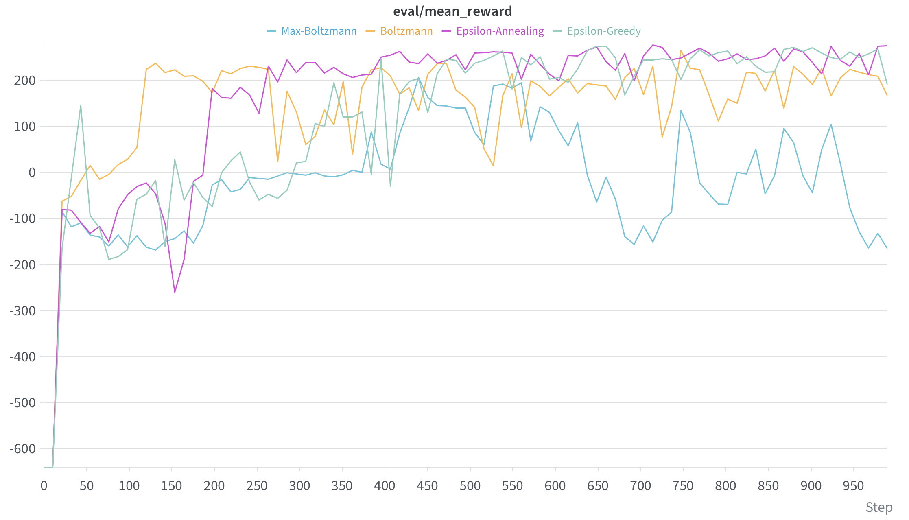
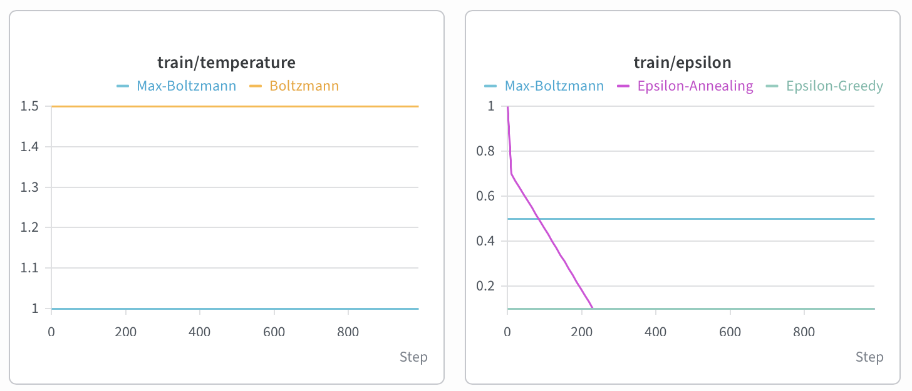
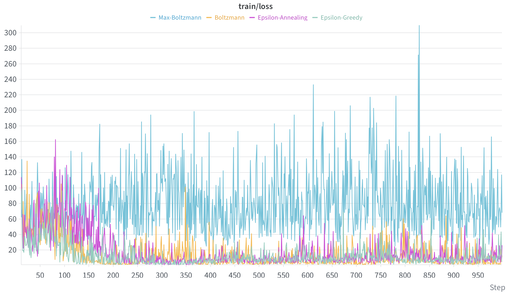

# Implementation of DQN Exploration Strategies: From Theory to Production


-lightgrey.svg)


## 1. Abstract & Objective

This project is a fully functional, scalable PyTorch implementation of Deep Q-Network (DQN) exploration strategies. The primary objective is to bridge the gap between academic reinforcement learning concepts (specifically the exploration-exploitation dilemma) and a production-ready pipeline.

Instead of static datasets, the pipeline dynamically generates experience through the continuous-state `LunarLander-v3` environment. This allows for the isolated testing of various exploration mechanisms when handling complex probabilistic agent-environment interactions. The architecture is optimized for maximum computational efficiency by explicitly decoupling the Experience Replay buffer, network architectures, and agent logic, while strictly eliminating redundant tensor operations during stochastic exploration steps.

## 2. Architecture & Mathematical Formulation

The model consists of several key modules designed to stabilize off-policy learning and efficiently balance state-space discovery with reward maximization:

### 2.1 Deep Q-Network (DQN) Objective

The Q-Network is optimized to minimize the Mean Squared Error (MSE) over the Temporal Difference (TD) target. Given a transition tuple $(s, a, r, s')$, the loss function is computed across a sampled batch from the Experience Replay buffer $D$:

$$
\mathcal{L}(\theta) = \mathbb{E}_{(s,a,r,s') \sim U(D)} \left[ \left( r + \gamma \max_{a'} Q(s', a'; \theta^-) - Q(s, a; \theta) \right)^2 \right]
$$

where $\theta$ represents the online network weights, $\theta^-$ represents the target network weights (updated periodically to ensure stability), and $\gamma$ is the discount factor.

### 2.2 Epsilon-Greedy & Annealing

Instead of a fixed exploration rate, the **$\epsilon$-Annealing** mechanism decays the exploration probability linearly over $T_{\text{anneal}}$ steps. This allows the model to transition smoothly from uniform exploration to greedy exploitation:

$$
\epsilon_t = \max\left(\epsilon_{\text{final}}, \epsilon_{\text{start}} - \frac{\epsilon_{\text{start}} - \epsilon_{\text{final}}}{T_{\text{anneal}}} t\right)
$$

### 2.3 Boltzmann & Max-Boltzmann Routing

To leverage the Q-Network's estimations even during exploration, **Boltzmann Exploration** replaces uniform random action selection with a Softmax distribution over the predicted Q-values, scaled by a temperature parameter $\tau$:

$$
p(a|s) = \frac{\exp(Q(s,a)/\tau)}{\sum_{a'} \exp(Q(s,a')/\tau)}
$$

**Max-Boltzmann** acts as a hybrid routing mechanism. With probability $1-\epsilon$ the agent acts greedily, but with probability $\epsilon$ it samples from the Boltzmann distribution instead of a uniform distribution, preventing the selection of mathematically catastrophic actions during the exploration phase.

## 3. Visualizations

The architecture's training is tracked in Weights & Biases. The charts below demonstrate the stable convergence of the evaluation rewards and the dynamics of different exploration strategies.

### Performance Benchmark


*Figure 1: Mean Evaluation Reward across 100,000 steps. The $\epsilon$-annealing strategy demonstrates the most robust convergence, steadily surpassing the environment's solve threshold (>200).*

### Exploration Dynamics & TD-Loss


*Figure 2: Hyperparameter schedules tracking Epsilon decay (linear annealing from 1.0 to 0.1) and fixed Boltzmann Temperature.*



*Figure 3: Temporal Difference (TD) Loss optimization stability across different routing strategies.*

## 4. Evaluation Metrics & Results

Pipeline performance was evaluated using the Mean Evaluation Reward over 100,000 training steps across 6 synchronized environments. Training on Apple Silicon (MPS) yielded the following results:

| Strategy | Key Hyperparameters | Computation | Max Eval Reward |
| :--- | :--- | :--- | :--- |
| **Epsilon-Greedy** | $\epsilon = 0.1$ | Optimized | ~270.53 |
| **Epsilon-Annealing** | $\epsilon \in [1.0, 0.1], T=30k$ | Optimized | **~276.11** |
| **Boltzmann** | $\tau = 1.5$ | Full Forward Pass | ~168.24 |
| **Max-Boltzmann** | $\epsilon = 0.5, \tau = 1.0$ | Optimized | ~ -164.46 |

### Exploration Strategy Analysis

Several autoregressive exploration strategies were tested during the training lifecycle:

-   **Epsilon-Annealing (Best):** Linear decay from 1.0 to 0.1 allowed the agent to collect highly diverse experiences in the early stages, while safely exploiting the well-trained Q-Network for stable landings in the final stages.
-   **Max-Boltzmann (Worst):** Using a fixed $\epsilon = 0.5$ without an annealing schedule forced the agent to make non-greedy, stochastic steps 50% of the time throughout the entire training process. This proved fatal for a precision-heavy continuous control task like landing a lunar module.
-   **Redundant Computation Optimization:** In standard naive $\epsilon$-based implementations, agents perform a full dense forward pass on the entire batch before applying a random action mask. This pipeline optimizes FLOPs by pre-generating the stochastic mask and executing the $Q(s)$ forward pass *only* for environment indices that strictly require a greedy action.

## 5. Quick Start

The project uses `uv` for ultra-fast dependency and virtual environment management. All routine processes and benchmarking targets are encapsulated within the `Makefile`.

```bash
# Clone the repository and install dependencies
git clone https://github.com/PavelCharheika/dqn-exploration-strategies.git
cd dqn-exploration-strategies
make setup

# Run the complete benchmarking suite (all 4 experiments sequentially)
make train-all

# Alternatively, run isolated experiments (e.g., the best performing model)
make train-eps-annealing
```